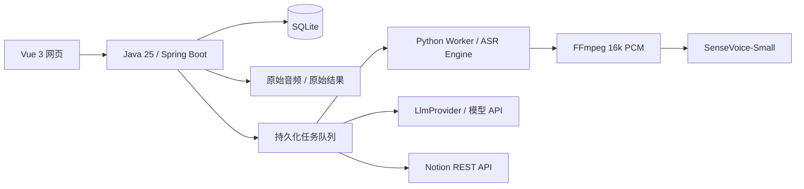

# 架构与扩展

## 三个模块



`Store` 负责数据库事务与状态变更，`JobRunner` 在应用完全就绪后每秒领取一个任务。领取任务和提交结果都是短事务；模型调用与 HTTP 请求不占用 SQLite 事务。SQLite 使用 WAL、外键、10 秒 busy timeout，连接池单连接以串行化本机写入。

`TRANSCRIBE → SUMMARIZE` 可以自动衔接，也能独立触发。`SYNC` 仅在用户确认当前版本后手动触发。队列不进行无限自动重试，失败留下本次任务记录，手动重试新增 attempt。Notion 的 429 与 Retry-After 在日志中可见，稍后重试。

## 数据与状态

| 表 | 保存的数据 |
|---|---|
| `recordings` | 音频信息、课程、日期、分类及三个独立阶段状态 |
| `transcripts` | 各次成功转录、提供者、时间段、全文 |
| `notes` | 当前笔记、revision、confirmed revision、synced revision、Notion 映射与不确定创建意图 |
| `note_versions` | 每次 AI 生成与手动保存的完整版本 |
| `jobs` | 阶段、状态、attempt、时间、错误和提交时的笔记 revision |
| `logs` | 录音 / 任务日志 |
| `artifacts` | ASR / LLM / Notion 响应以及生成的 Markdown |
| `settings` | 配置，凭证密文 |

任务状态：`QUEUED`、`RUNNING`、`SUCCEEDED`、`FAILED`。还没有任务的阶段用 `PENDING`，刚上传时用 `UPLOADED`。数据库部分索引保证同一录音只有一个活跃任务。

原始响应和分段 journal 在解析、合并前写入；未完成的结果不会替换上一次成功结果。Worker 返回分段与全文，以及原始文件路径。JSONL 保存模型的原始标记和文本，全文仅执行完全相同的边界去重，时间轴仍保留全部窗口文本。

## ASR 替换接口

Java 的 `AsrProvider` 接收任务和音频 Path，返回统一 `AsrResult`。默认 `PythonAsrProvider` 通过本机 HTTP 调用 Worker。换成其他服务时可实现这个接口，同时保持原始响应保存行为。

Python 的 `Engine` 定义如下：

```python
class Engine(Protocol):
    name: str
    def recognize(self, audio: Path) -> tuple[str, Any]: ...
```

`audio` 是不超过 30 秒的 16kHz、单声道、PCM16 WAV。返回清理后的文本与可 JSON 序列化的原始结果。音频转换、窗口分段、文件保留和时间轴由 `Transcriber` 统一处理。

例如新增 `worker/my_whisper.py`：

```python
from pathlib import Path
from faster_whisper import WhisperModel

class WhisperEngine:
    name = "whisper-local"
    def __init__(self):
        self.model = WhisperModel("small", device="cpu", compute_type="int8")
    def recognize(self, audio: Path):
        segments, info = self.model.transcribe(str(audio), language="zh")
        raw = [dict(start=s.start, end=s.end, text=s.text) for s in segments]
        return "".join(s["text"] for s in raw).strip(), raw

def create_engine():
    return WhisperEngine()
```

单独安装所选模型依赖，设置 `ASR_ENGINE_MODULE=my_whisper`，重启 Worker 即可。此示例是接口接入模板，本次未安装或验证 Whisper。Qwen3-ASR 可以实现同一接口；若要使用词级/句级对齐，可扩展结果合约，为 `timestampKind` 提供准确类型并更新 Java 校验及前端提示。

## LLM 替换接口

`LlmProvider.complete(Job, system, content)` 返回正式 Markdown。默认实现适配 `/chat/completions`，读取 `choices[0].message.content`，不将推理字段或工具调用写入笔记。要适配另一种协议，在 Java 增加新的实现并调整 Spring Bean 条件装配，保留以下行为：

- HTTP 原始结果保存后再解析。
- 检查回答是否正常结束，截断内容应失败而非保存为完整笔记。
- 将转录当作资料而不是指令；强调来源、条件、易错点和「待核对」。
- 提取阶段的截断必须失败，不能保存不完整知识；可选的全文合并触发 `LlmOutputLimitException` 时可退回完整分段笔记，其他错误继续上报。

`KnowledgeExtractor` 按字符上限无遗漏分段，并在换行附近切分，保护 UTF-16 surrogate pair。每段结果立即保存为 `SUMMARY_PART`。全部笔记能放入一次请求时至多合并一次；否则直接按原顺序组装，各段 Markdown、公式、代码块及来源时间保持原样。合并结果为空、超过本次字符预算或触发输出截断时也使用完整分段笔记，不再递归压缩或切割生成的 Markdown。

单篇笔记的生成和编辑上限统一为 2,000,000 个 UTF-16 字符。生成的全文先写入 `GENERATED_MARKDOWN` 再检查上限，即使超限也可查看或复制原始结果。原始转录和已完成分段不会被删除。字符预算是兼容不同模型的粗略控制，实际 token 上限由服务商决定；提取单段仍超出模型上下文时应调小分段。

## 笔记 AI 对话

`REFINE` 与其他任务共用持久队列和单录音互斥。`note_ai_turns` 保存用户要求、正式回复、任务和版本关联，数据库格式 v3 的迁移先备份数据及密钥。读取最近 40 条对话，模型上下文使用最近 3 条成功对话并限制总长度。

`NoteRefiner` 对长笔记逐段请求精确替换 JSON，要求 `before` 原样且在该段唯一匹配，不允许重叠。所有分段成功后才按原始位置组装；未匹配修改的文字逐字保留，不重新生成整篇。任一段返回无效格式、定位歧义、截断或网络错误时，整次修改失败，现有笔记不变，原始响应仍保留。

生成的候选全文先保存为原始结果。提交时再次检查笔记版本，有人工编辑则拒绝覆盖；成功的正文修改保存 `AI_CHAT` 新版本，撤销确认并等待重新核对后同步。没有实际修改的对话只保存回复，不增加笔记版本。

`llmSystemPrompt` 默认采用内置知识提取提示词，设置中可以调整；任务开始后保持该次提示词不变。恢复默认仅删除此设置覆盖项，不改动模型、凭证或其他配置。

## Notion 同步边界

Notion 查询和本地 SQLite 之间没有分布式事务。用四层措施处理重试：单录音串行任务、远端 Source ID 查重、立即保存 page ID、创建前持久化不确定意图。远端重复来源、目标改变、页面归档或创建不确定时停止并提示核对。

内容更新使用幂等替换，成功响应后才设置 `synced_revision`。同步执行期间禁止保存笔记以保持确认版本一致。默认保护 Notion 子页面与子数据库，不开启 `allow_deleting_content`。

## 部署边界

适用于一台机器上的单用户工作空间。Java 与 Worker 绑定回环地址。跨公网使用前需要单独设计身份验证、访问控制、上传配额、TLS 和密钥管理；当前 API 无多租户隔离。SQLite 数据目录必须保留本机进程锁，不能同时启动多实例处理同一份队列。
